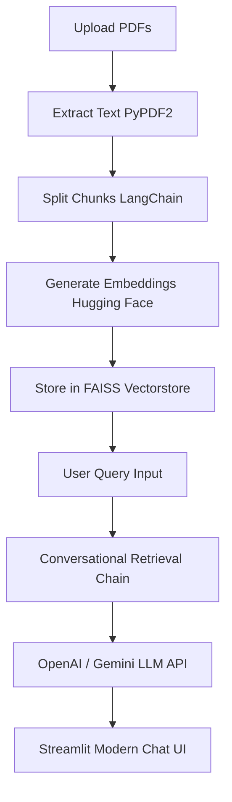

# Chat with PDF 📚

An intelligent, modern Streamlit-based web application that allows you to upload multiple PDF documents and ask questions about their content in plain English. Powered by LangChain, OpenAI, and Google Gemini.

---

## 🚀 Features

- **Multi-Model Support**: Choose between **OpenAI (GPT-3.5/GPT-4o)** and **Google Gemini** directly from the sidebar.
- **Native Streamlit Chat UI**: A polished interface utilizing Streamlit's native `st.chat_message` blocks, featuring clean bubbles, markdown, copy-to-clipboard, and formatting support.
- **Robust PDF Processing**:
  - Extracts text from multiple PDFs concurrently.
  - Splits text into optimal, overlapping semantic chunks using LangChain's text splitters.
- **Efficient Vector Search**: Employs **FAISS** (Facebook AI Similarity Search) and Hugging Face Embeddings (`all-MiniLM-L6-v2`) for ultra-fast, local similarity retrieval.
- **Interactive Conversational Memory**: Remembers context from previous questions within the session to support follow-up questions.
- **Sidebar Workspace Controls**:
  - File uploader with listing of uploaded document names.
  - LLM Provider selector.
  - **Clear Chat** button to easily reset the session history.

---

## 🛠️ System Architecture



---

## ⚙️ Setup & Installation

### 1. Prerequisites
- Python 3.9 or higher installed on your computer.

### 2. Clone the Repository & Install Dependencies
Navigate to the project directory and install the requirements:
```bash
pip install -r requirements.txt
```

### 3. Configure API Credentials
Create a `.env` file in the root of the project directory (or edit the existing one) and add your keys:
```env
OPENAI_API_KEY=your_openai_api_key_here
GEMINI_API_KEY=your_gemini_api_key_here
```

### 4. Run the Web Application
Start the Streamlit server:
```bash
streamlit run app.py
```
Open the provided local URL (usually `http://localhost:8501`) in your browser to start chatting with your PDFs!

---

## 🛡️ License

This project is open-source and available under the [MIT License](LICENSE).
