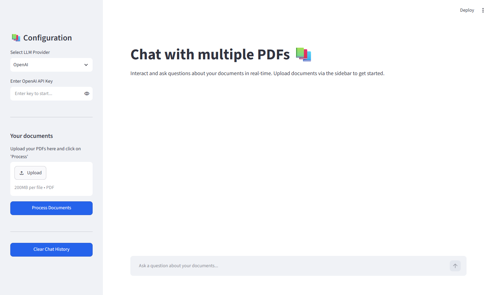
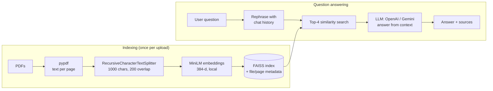
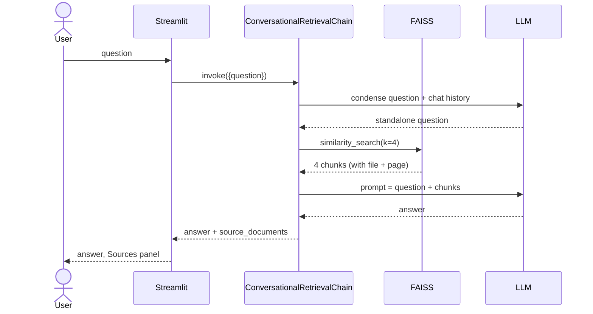

# Chat with PDF

Upload one or more PDFs and ask questions about them in plain English. Answers come with the **file name and page number** they were taken from, so you can check them.

It's a Retrieval-Augmented Generation (RAG) app built with Streamlit, LangChain and FAISS. You can switch between OpenAI and Google Gemini as the LLM.



---

## Features

- **Multiple PDFs at once.** Text is extracted page by page and every chunk remembers its source file and page.
- **Local embeddings.** `all-MiniLM-L6-v2` (sentence-transformers) runs on CPU, so documents are never sent to an embedding API.
- **FAISS vector search.** The top 4 most similar chunks are retrieved for each question.
- **Follow-up questions.** Conversation memory rewrites "what about the second one?" into a standalone question before retrieval.
- **Source citations.** Each answer has a *Sources* panel with the file, page and a snippet of the text used.
- **Two LLM providers.** OpenAI `gpt-4o-mini` or Gemini `gemini-2.5-flash`, chosen in the sidebar.

## How it works



### Request flow for one question



### Design choices

| Choice | Why |
|---|---|
| Chunk size 1000, overlap 200 | Big enough to hold a full paragraph, and the overlap stops a sentence from being cut between two chunks. |
| Recursive splitter | Splits on paragraphs first, then lines, then words, so chunks stay readable. |
| Local MiniLM embeddings | Free and private, and fast enough on CPU for a few hundred pages. |
| FAISS in memory | No database to run. The index is rebuilt when new files are processed. |
| `k = 4` | Enough context for most questions without pushing the prompt too long. |
| Page-level metadata | Makes citations possible and lets the user check answers against the source. |

## Setup

```bash
git clone https://github.com/Sapair-og/chat-with-pdf.git
cd chat-with-pdf
python -m venv .venv
.venv\Scripts\activate         # Linux/macOS: source .venv/bin/activate
pip install -r requirements.txt
```

Create a `.env` file (or paste the key into the sidebar instead):

```env
OPENAI_API_KEY=sk-...
GEMINI_API_KEY=...
```

Run:

```bash
streamlit run app.py
```

Open http://localhost:8501, upload PDFs in the sidebar, click **Process Documents**, and start asking questions.

## Project structure

```
app.py             Streamlit UI + RAG pipeline
requirements.txt   pinned dependency ranges
```

Main functions in `app.py`:

| Function | Role |
|---|---|
| `get_pdf_pages` | Reads each PDF page into a LangChain `Document` with `source` and `page` metadata |
| `get_text_chunks` | Splits pages into overlapping chunks |
| `get_vectorstore` | Embeds chunks and builds the FAISS index |
| `get_conversation_chain` | Wires the LLM, retriever and memory into a `ConversationalRetrievalChain` |
| `format_sources` / `render_sources` | De-duplicates retrieved chunks and shows them under each answer |

## Limitations and ideas

- Scanned PDFs have no text layer. They would need OCR (e.g. Tesseract) before indexing.
- The index lives in memory and is lost on restart. Saving it with `FAISS.save_local` would fix that.
- Retrieval is pure vector search. Adding BM25 (hybrid search) and a re-ranker would help with exact terms such as IDs and names.
- No automatic evaluation yet. A small question/answer set scored with RAGAS would make retrieval changes measurable.

## License

MIT
